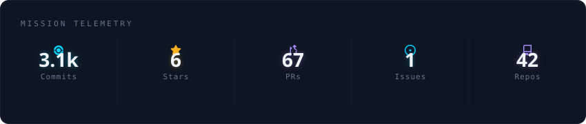

##  Hello, world! 🌎

Olá, me chamo **Caio Machado** e sou **Software Engineer na [Bázico](https://sejabazico.com.br)**, onde desenvolvo APIs, integrações com Shopify, pipelines de dados e automações com n8n.

Programo desde **2020**, quando a curiosidade sobre como os computadores funcionam me levou ao desenvolvimento. Hoje meu foco é **backend**: Python (Django, FastAPI), Java (Spring Boot), PostgreSQL e Docker. Em paralelo, curso **Sistemas de Informação na UNIT** (7º período).

  
 

 

  

 

  

 

  

 

  

 
